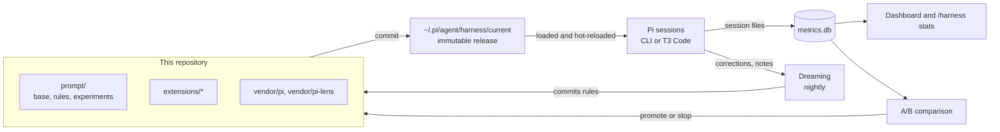

# pi-harness

A self-improving coding-agent harness built on [Pi](https://github.com/earendil-works/pi). It replaces Pi's system prompt and tooling with its own, measures every session from Pi's session files, tests prompt and tool changes as randomized A/B experiments on real work, and learns new working rules from the user's corrections overnight. Every change is a git commit, so it is visible and can be reverted.

> **Status: reference implementation.** This is the author's daily driver, published to show how the pieces fit together. It is not a packaged product. The installer assumes the author's setup: macOS, an Anthropic-compatible model gateway, and [T3 Code](https://github.com/pingdotgg/t3code) as the front end. Read it, borrow from it, and adapt it. [Installation](docs/install.md) lists exactly what it expects.

## Why

Coding agents are usually tuned by gut feeling: someone edits the system prompt, it feels better, and it ships. This harness treats the agent as a system to be measured instead:

- **Measure inside the harness.** Cost, cache rebuilds, context size, tool usage, subagents and the user's corrections are derived from Pi's own session files. No proxy or gateway logs are needed.
- **Change in small, revertible steps.** The prompt is a minimal base plus one file per rule. Each rule began as an experiment and can be deleted on its own.
- **Evaluate on real sessions.** Sessions are split 50/50 per experiment, and the arms are compared with bootstrap confidence intervals. There is no offline benchmark.
- **Learn from corrections.** A nightly "dreaming" job labels what the user typed, turns repeated corrections into rules, and commits them.
- **Deploy by committing.** A commit to `main` reaches every running session within seconds, between two turns, without a restart.

The design is grounded in a literature and source-code survey of how other harnesses manage context, and in an analysis of 1,616 of the author's own sessions. See [docs/research](docs/research/context-engineering/README.md).

## Features

| Area | What it does | Docs |
| --- | --- | --- |
| Prompt | Minimal hand-written base prompt, global working rules, one section per promoted rule; edits reach running sessions without breaking the prompt cache | [prompt.md](docs/prompt.md) |
| Experiments | Randomized A/B arms per session for prompt sections and tools, compared with 95% bootstrap intervals; promote or stop with one command | [prompt.md](docs/prompt.md#experiments) |
| Releases | Each commit becomes an immutable release, passes an import check, and is hot-reloaded into running sessions at the next turn boundary | [releases.md](docs/releases.md) |
| Metrics | SQLite index over Pi's session files: per-request cost split by billing rate, cache-rebuild attribution, compactions, idle pauses, subagent economics, harness versions | [metrics.md](docs/metrics.md) |
| Dashboard | Local web UI for the metrics: overview, cost drivers, context and tools, sessions, waste, subagents, harness versions | [metrics.md](docs/metrics.md#dashboard) |
| Self-improvement | `note_improvement` friction capture, nightly dreaming that turns corrections into rules, changelog | [self-improvement.md](docs/self-improvement.md) |
| Bash | Long commands move to the background after 2 minutes and wake the agent when they finish; a guard against orphaned background processes; `tool <name>` calls any agent tool from a shell script | [tools.md](docs/tools.md#bash) |
| Workflows | The agent writes TypeScript scripts that do a procedure in code and call a model only for judgments (`llm()`, `agent()`); saved workflows become tools; `fix_loop` hands a failing check to a cheaper child agent | [tools.md](docs/tools.md#workflow-and-fix_loop) |
| Other tools | Asynchronous `ask_user`, `web_search` / `web_fetch` through Anthropic server tools, layered [pi-lens](https://github.com/apmantza/pi-lens) configuration (LSP, linters, structural search) | [tools.md](docs/tools.md) |

## How it fits together



More detail: [docs/architecture.md](docs/architecture.md).

## Repository layout

```text
prompt/        base.md (system prompt), AGENTS.md (author's working rules), rules/, experiments/
extensions/    Pi extensions, one directory each; lib/ holds the shared modules
dashboard/     usage dashboard: node:http server and React frontend
scripts/       install.mjs, patch-t3.ts, dream/ (nightly learning), evidence/ (research analyses)
workflows/     workflows shipped as tools (fix_loop)
config/        global pi-lens configuration
docs/          documentation and research
test/          node:test suite
vendor/        Pi and pi-lens as squashed git subtrees, with local patches
```

## Getting started

Requirements: macOS, Node.js 24 or later (the TypeScript sources run directly through Node's type stripping), an Anthropic-compatible gateway, and optionally T3 Code. [docs/install.md](docs/install.md) covers what the installer changes and how to adapt it.

```sh
git clone https://github.com/samuelscheit/pi-harness.git
cd pi-harness
ANTHROPIC_BASE_URL=https://your-gateway.example ANTHROPIC_AUTH_TOKEN=… node scripts/install.mjs
pi                 # or pick Pi as the provider in T3 Code
```

Inside a session:

```text
/harness stats [all]                                   cost, cache, tools, versions for this project (or all)
/harness dashboard                                     open the usage dashboard (http://127.0.0.1:4317)
/harness experiment [<name> on|off|stop|promote]       list, force, stop or promote experiments
```

Development:

```sh
npm test           # node:test suite and dashboard tests
npm run check      # type checks for the harness, workflows and dashboard
npm run metrics -- --since 2026-11-01   # the stats report from a shell
```

## Documentation

- [Architecture](docs/architecture.md): components and the data flow between them
- [Installation](docs/install.md): requirements, what the installer writes, T3 Code integration, bundled Pi and pi-lens
- [Prompt, rules and experiments](docs/prompt.md)
- [Releases and hot reload](docs/releases.md)
- [Tools](docs/tools.md): bash, workflows, `ask_user`, web, pi-lens
- [Metrics and dashboard](docs/metrics.md)
- [Self-improvement](docs/self-improvement.md): notes, dreaming, changelog
- [Roadmap and open questions](docs/roadmap.md)
- [Research: context engineering for LLM harnesses](docs/research/context-engineering/README.md)

## Credits

- [Pi](https://github.com/earendil-works/pi) by Mario Zechner (MIT) is the agent this harness extends. It is bundled in `vendor/pi` with patches described in [docs/install.md](docs/install.md#bundled-pi-and-pi-lens).
- [pi-lens](https://github.com/apmantza/pi-lens) by Apostolos Mantzaris and contributors (MIT) supplies LSP, linting and structural code tools. It is bundled in `vendor/pi-lens`.
- The `ask_user` tool description comes from [OpenAI Codex CLI](https://github.com/openai/codex) (Apache-2.0). See [NOTICE](NOTICE).

## License

[MIT](LICENSE) for this repository's own code. The bundled packages in `vendor/` keep their own licenses.
