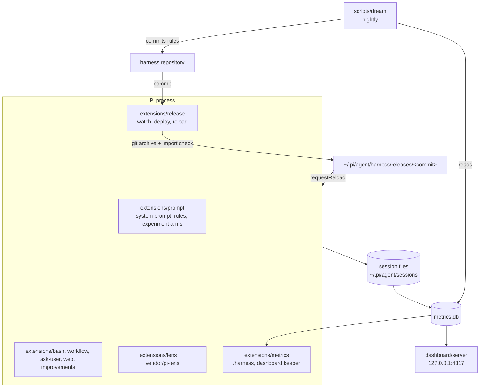

# Architecture

The harness is a [Pi](https://github.com/earendil-works/pi) package: a set of Pi extensions, a system prompt, and a few scripts around them. Pi does the agent loop, provider requests, sessions and compaction. The harness decides what the model sees, which tools it has, how changes are deployed, and how sessions are measured.

## Goals

These are the decisions the design follows:

- **Improve globally and per project.** Global changes live in this repository: prompt, rules, extension settings. Per-project changes live in the project: `<repo>/AGENTS.md`, `<repo>/.agents/skills/`, `<repo>/.pi/`. The per-project layout is harness-neutral, so other agents can read it too.
- **Measure inside the harness.** Pi's session files are the source of truth. `~/.pi/agent/metrics.db` is an index that can be rebuilt from them at any time.
- **Evaluate live.** Changes are compared across real sessions with randomized arms. Comparing harness versions before and after is confounded by the task mix and by project AGENTS.md edits.
- **Promote automatically, but visibly.** Every change is a commit with a changelog entry, so it is revertible.
- **Keep the base minimal.** The system prompt grows only when evidence shows a gap.
- **Leave orchestration to the front end.** No built-in subagents, plan mode or task list: [T3 Code](https://github.com/pingdotgg/t3code) provides delegation, threads, scheduling and background monitoring.

## Components

| Module | Role |
| --- | --- |
| [`extensions/prompt`](../extensions/prompt/index.ts) | Builds the system prompt on every run: `prompt/base.md`, `prompt/AGENTS.md`, each rule in `prompt/rules/`, the experiment sections of the session's arm, and the active tools' guidelines. Switches tools per rule and arm. |
| [`extensions/lib/release.ts`](../extensions/lib/release.ts), [`extensions/release`](../extensions/release/index.ts) | Turn commits into immutable releases and reload running sessions into them. |
| [`extensions/metrics`](../extensions/metrics/index.ts) | Index session files into SQLite, run the query layer, the `/harness` command, and keep the dashboard running. |
| [`extensions/lib/experiments.ts`](../extensions/lib/experiments.ts), [`extensions/lib/rules.ts`](../extensions/lib/rules.ts) | A/B experiment assignment, and promoted rules. |
| [`extensions/background`](../extensions/background/index.ts) | Moves every tool call still running after two minutes (or when a user message arrives) to the background; its end wakes the session. |
| [`extensions/bash`](../extensions/bash/index.ts) | Owns the `bash` tool: tracking of processes a command leaves running, refusal of self-detaching commands, `tool` bridge. |
| [`extensions/workflow`](../extensions/workflow/index.ts) | The `workflow` tool and saved workflows as tools; durable runs (journal, replay, resume) and their pages. |
| [`extensions/ask-user`](../extensions/ask-user/index.ts) | `ask_user` on Pi dialogs: waits for the answers or a chat reply; unanswered in time, they arrive later as a message. |
| [`extensions/web`](../extensions/web/index.ts) | `web_search` and `web_fetch` through Anthropic server tools. |
| [`extensions/improvements`](../extensions/improvements/index.ts) | `note_improvement`, the agent's friction log. |
| [`extensions/goal`](../extensions/goal/index.ts) | `/goal` and the `goal` tool: a session goal that holds the run at its end until it is achieved, blocked or out of budget ([goal.md](goal.md)). |
| [`extensions/template`](../extensions/template/index.ts) | Session templates: recipes in `.pi/templates/`, deterministic builds, staleness and rebuilds, `/template` ([templates.md](templates.md)). |
| [`extensions/warm`](../extensions/warm/index.ts) | `/warm` and the `keep_warm` tool: hold the prompt cache warm until a time, with a budget ([tools.md](tools.md#warm-and-keep_warm)). |
| [`extensions/lens`](../extensions/lens/index.ts) | Layered global and per-project configuration for pi-lens. |
| [`dashboard/`](../dashboard) | `node:http` JSON API over the query layer, plus a React frontend. |
| [`scripts/dream`](../scripts/dream/run.ts) | Nightly learning from user corrections. |
| [`scripts/install.mjs`](../scripts/install.mjs) | Builds and links the bundled Pi, writes Pi's settings, deploys the first release. |
| [`scripts/patch-t3.ts`](../scripts/patch-t3.ts) | Keeps T3 Code's Pi adapter patched across T3 updates. |

## Lifecycle of a change

1. Someone edits the harness: the user, an agent, the dreaming job, or `/harness experiment … promote`.
2. They commit to `main`. Uncommitted edits never reach a session.
3. The first Pi process that notices the commit archives it into `~/.pi/agent/harness/releases/<commit>`. It checks that every extension imports in a fresh Node process, then switches `current` to the new release.
4. Every session reloads: at once when idle, otherwise at the next turn boundary. The prompt extension rebuilds the system prompt. Pi sends changed sections as appended system messages, so the cached prompt prefix survives.
5. New sessions record the harness version, a hash of their prompt sections and initial tools, and their experiment arms. The metrics index groups by both.
6. Once there is enough data, `/harness experiment <name>` compares the arms, and the experiment is promoted to a rule or stopped. Both write a changelog entry and commit.

## Where state lives

| What | Where | Versioned |
| --- | --- | --- |
| Prompt, rules, experiments, extensions, global pi-lens config | this repository | yes |
| Deployed releases | `~/.pi/agent/harness/` | no (built from commits) |
| Pi configuration written by the installer | `~/.pi/agent/{settings,models,auth}.json` | no |
| Sessions | `~/.pi/agent/sessions/` (Pi) | no; the source of truth for metrics |
| Metrics index | `~/.pi/agent/metrics.db` | no; rebuilt from sessions |
| Template recipes | `<repo>/.pi/templates/`, `templates/` here | yes |
| Built and captured templates | `~/.pi/agent/templates/<name>/<scope>/` | no; rebuilt from recipes |
| Workflow journals, start snapshots and pages | `~/.pi/agent/workflows/<id>/` | no; a day after the run ended, a week when interrupted or stopped |
| Improvement notes, changelog, dream ledger and reports | `.agents/` in this repository (git-ignored in the public repository) | locally |
| Project rules and settings | `<repo>/AGENTS.md`, `<repo>/.pi/`, `<repo>/.agents/` | in that project |
